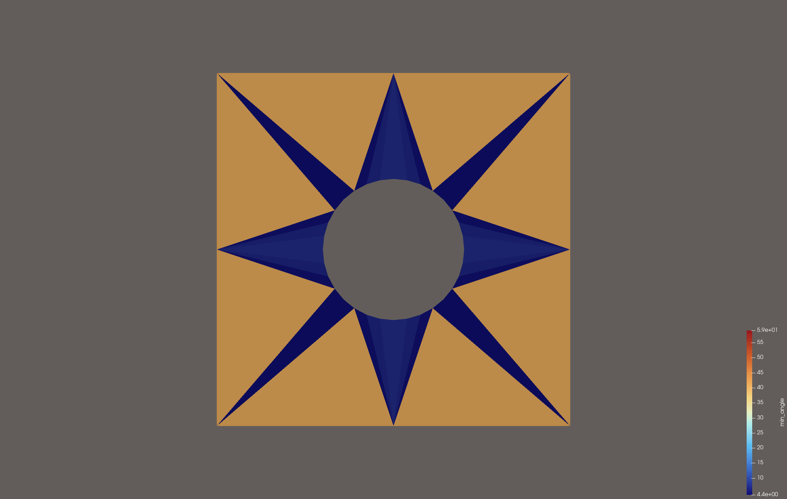
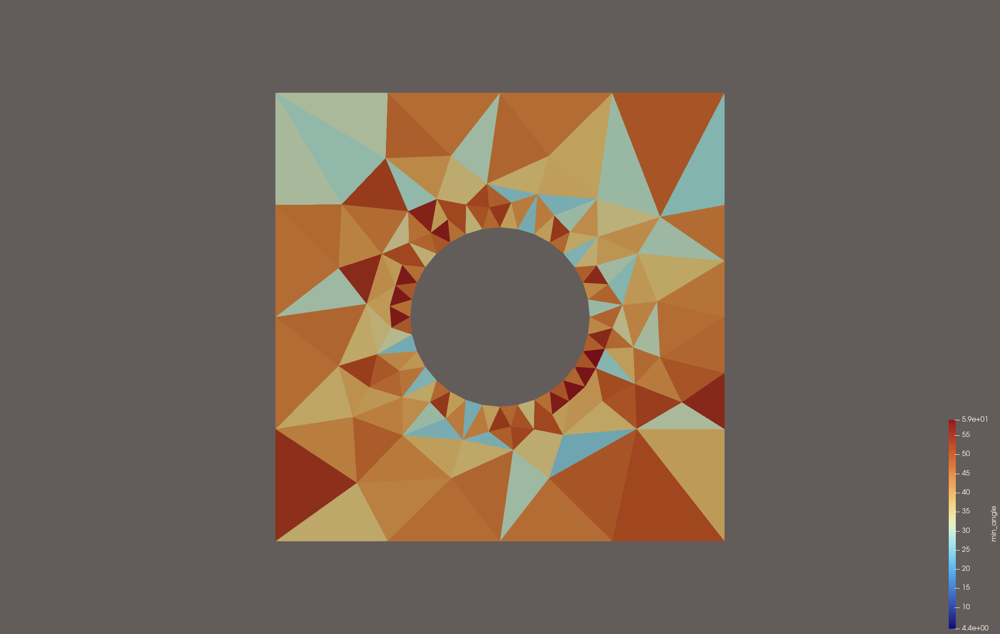
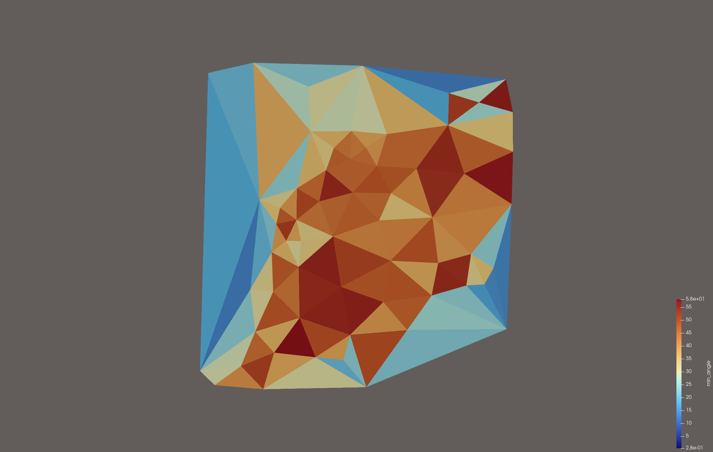
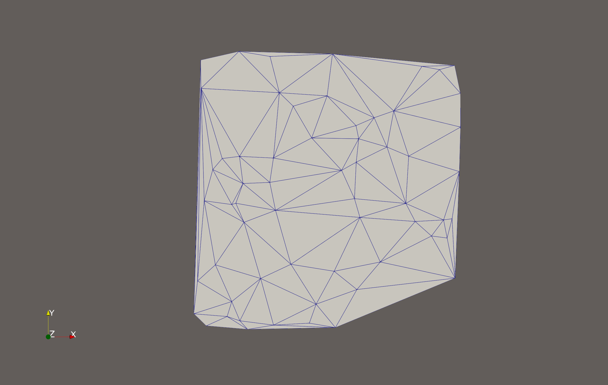

# meshkit

[](https://github.com/nikoslaz/mesh-kit/actions/workflows/ci.yml)

A small C++20 toolkit for 2D triangle meshes: Delaunay triangulation, **quality mesh
generation from a boundary (Ruppert's algorithm)**, mesh quality metrics, Laplacian
smoothing, and pluggable mesh readers/writers (Gmsh in, VTK and Nastran out) selected from
a config file. A Python script runs it in batch and reports mesh quality.

| Boundary only (min angle 4.4°, 40 triangles) | After Ruppert refinement (min angle 24.6°, 172 triangles) |
|---|---|
|  |  |

*A 10×10 plate with a circular hole, meshed from its boundary alone
(`meshkit_cli plate 1.2 32`). Coloured by each triangle's smallest angle, same colour scale
in both pictures, viewed in ParaView.*

## Smoothing and Delaunay

| Before smoothing (min angle 0.28°) | After 10 Laplacian iterations (min angle 12.3°) |
|---|---|
|  |  |

*60 random points triangulated with Bowyer-Watson, coloured by each triangle's
smallest angle (blue = poor, red = good), viewed in ParaView.*



*Delaunay triangulation of the same 60 points (wireframe).*

## Features

- **Delaunay triangulation** (Bowyer-Watson) using robust adaptive-precision orientation and
  in-circumcircle predicates (Shewchuk), tested against an independent convex hull on grids
  and random point sets. On a set of nearly collinear points, a plain floating-point
  orientation test gave a vertex-order-dependent sign in 13,968 of 65,536 cases (21%); the
  robust predicates gave 0 (see `tests/test_geometry.cpp`).
- **Quality mesh generation** (Ruppert's algorithm): give it a boundary (points, segments,
  holes) and a limit on the radius-edge ratio, and it returns a mesh whose triangles all
  respect the limit, with every boundary segment kept as mesh edges (see below).
- **Quality metrics**: per-triangle minimum angle and radius-edge ratio.
- **Laplacian smoothing**: interior vertices move to the average of their neighbours;
  boundary vertices stay fixed.
- **Mesh I/O** behind abstract `MeshReader` / `MeshWriter` interfaces, created by
  factory functions (`makeReader("gmsh")`, `makeWriter("vtk" | "nastran")`):
  - Gmsh MSH 2.2 ASCII reader (triangles; arbitrary node ids)
  - VTK legacy writer (optionally with per-cell data, for ParaView)
  - Nastran bulk data writer (`GRID` / `CTRIA3`, free format)
- **Config-driven CLI**: a `key = value` file chooses reader, writer, files and smoothing.
- **Python batch script** that converts a folder of meshes and prints quality histograms.

## Quality meshing (Ruppert's algorithm)

`meshDomain(domain, maxRatio)` turns a boundary description into a mesh. A `Domain` is a
list of points, a list of segments (the walls, as pairs of point indices) and one marker
point inside each hole. The result has no triangle whose circumradius divided by its
shortest edge exceeds `maxRatio`. A radius-edge ratio of √2 corresponds to a minimum angle
of about 20.7°. Ruppert's termination proof needs a ratio of at least √2 and walls that do
not meet at very small angles (the 90° corners of the plate are fine); with smaller ratios
the program still often finishes, as in the table below, but without that guarantee, so
refinement stops after at most 10,000 steps.

How it works:

1. Triangulate the boundary points with incremental Bowyer-Watson, inside a large
   super-triangle that stays in the mesh until the end.
2. **Segment splitting**: a segment is *encroached* if another vertex lies inside the circle
   that has it as diameter. Encroached segments are split at their midpoint until none is
   left, so every wall ends up as a union of mesh edges, with no constrained Delaunay
   algorithm needed.
3. **Interior detection**: a flood fill over triangle neighbours starts from the
   super-triangle corners (outside) and from each hole marker, and is blocked by segments.
   Triangles it does not reach are inside the shape.
4. **Refinement**: while some interior triangle has a radius-edge ratio above the limit,
   insert its circumcenter. If that point would encroach a segment, split the segment
   instead.
5. Keep only the interior triangles and renumber the points.

Orientation and in-circle tests use Shewchuk's exact predicates, so nearly degenerate
inputs do not break the triangulation.

```bash
./build/meshkit_cli plate              # 10x10 plate, 16-sided hole, ratio sqrt(2)
./build/meshkit_cli plate 1.0          # stricter limit: finer mesh
./build/meshkit_cli plate 1.2 32       # ratio 1.2, 32-sided hole (the pictures above)
```

It writes `output/plate_coarse.vtk` (boundary fixed, no quality refinement) and
`output/plate.vtk` (refined), both with the minimum angle of each triangle as cell data.

| hole sides | max ratio | triangles before → after | min angle before → after |
|---|---|---|---|
| 16 | √2 | 24 → 64 | 8.3° → 21.4° |
| 16 | 1.0 | 24 → 90 | 8.3° → 32.2° |
| 32 | 1.2 | 40 → 172 | 4.4° → 24.6° |

From C++:

```cpp
#include "domain.hpp"
#include "refine.hpp"

Domain d = makePlateWithHole(32);        // or fill points / segments / holes yourself
Mesh mesh = meshDomain(d, 1.2);
```

The tests check, among other things, that the area of the result equals the exact area of
the shape, that every wall is a mesh edge, that no triangle exceeds the limit, and that the
topology is consistent (Euler's formula V − E + F = 0 for a plate with one hole).

## Build and test

Requires CMake ≥ 3.16 and a C++20 compiler.

```bash
cmake -S . -B build
cmake --build build
ctest --test-dir build --output-on-failure   # or: ./test.sh
```

## Usage

```bash
./build/meshkit_cli tests/convert.cfg   # convert according to a config file
./build/meshkit_cli demo                # writes output/random60_before/after.vtk
./build/meshkit_cli plate [ratio] [n]   # quality mesh of a plate with a hole, see above
```

Config file (`tests/convert.cfg`):

```ini
reader  = gmsh
writer  = nastran          # or vtk
input   = tests/data/square.msh
output  = output/square.bdf
smooth  = 0                # optional: Laplacian iterations
quality = output/square_quality.csv   # optional: per-triangle min angle before/after
```

From C++:

```cpp
#include "mesh_io.hpp"
#include "smoothing.hpp"

Mesh mesh = makeReader("gmsh")->read("part.msh");
laplacianSmooth(mesh, 10);
makeWriter("nastran")->write(mesh, "part.bdf");
```

## Batch quality report (Python)

Uses only the Python standard library.

```bash
python3 scripts/make_samples.py     # generates jittered grid meshes in tests/data/
python3 scripts/batch_quality.py    # converts all .msh files, smoothing 10 iterations
```

```
mesh                    points    tris  min before  min after  mean before  mean after
grid_10_jitter.msh         121     200       15.02      44.64        37.78       44.93
grid_10_regular.msh        121     200       45.00      45.00        45.00       45.00
grid_25_jitter.msh         676    1250        0.34      44.22        35.81       44.83
grid_50_jitter.msh        2601    5000        0.22      43.91        35.66       44.81
square.msh                   4       2       45.00      45.00        45.00       45.00
```

It also prints a histogram of the minimum angles before and after smoothing for each mesh.

## Project layout

```
include/        public headers (mesh, geometry, delaunay, domain, refine, topology, quality,
                smoothing, mesh_io, vtk_writer, predicate)
src/            library implementation (libmeshkit); predicate.c is Shewchuk's C code
apps/main.cpp   meshkit_cli
tests/          unit tests (geometry, Delaunay, domain, refinement, topology, I/O),
                sample config and meshes in tests/data/
scripts/        Python sample generator and batch quality report
docs/images/    screenshots used in this README
output/         generated files (VTK, Nastran, CSV); not committed
```

## Design notes

- A mesh is stored face-vertex style: a vector of points and a vector of triangles holding
  three point indices.
- File formats use 1-based ids; the reader maps Gmsh node ids to internal 0-based indices
  with a lookup table, so meshes with gaps in their numbering load correctly.
- Every triangle stores its three neighbours (`n0` is across from vertex 0, and so on; -1 means
  no neighbour). All triangles are counter-clockwise. Delaunay insertion locates the point by
  walking across neighbours and replaces the cavity in place, keeping the neighbours valid.
- Refinement keeps the super-triangle in the mesh until the end, so point indices stay
  stable while points are inserted; the interior is extracted once, at the end.
- Adding a format means adding one `MeshReader`/`MeshWriter` subclass and one line in its
  factory; the CLI and the batch script pick it up through the config file.

## Roadmap

- Multithreaded smoothing and quality evaluation, with benchmarks on large meshes
- Faster refinement (updating the interior and the list of bad triangles incrementally instead
  of recomputing them on every iteration). Triangulation itself is done: see `docs/benchmarks.md`
- A maximum triangle area, so the mesh can also be graded by size and not only by shape
- Reading a domain (points, segments, holes) from a file instead of the built-in plate
- More formats (Gmsh writer, Nastran reader) and quad elements

## Credits

`src/predicate.c` is Jonathan Richard Shewchuk's robust predicates code (public domain),
from <https://www.cs.cmu.edu/~quake/robust.html>. It is compiled as C and left unmodified.

## License

MIT, see `LICENSE`. `src/predicate.c` is in the public domain (see Credits).
