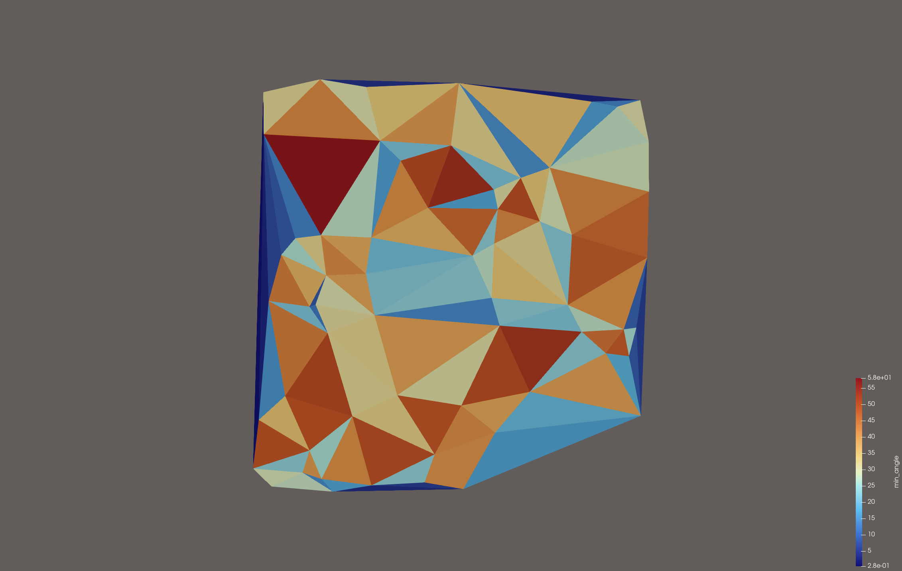

# meshkit

A small C++20 toolkit for 2D triangle meshes: Delaunay triangulation, mesh quality
metrics, Laplacian smoothing, and pluggable mesh readers/writers (Gmsh in, VTK and
Nastran out) selected from a config file. A Python script runs it in batch and
reports mesh quality.

| Before smoothing (min angle 0.28°) | After 10 Laplacian iterations (min angle 12.3°) |
|---|---|
|  |  |

*60 random points triangulated with Bowyer-Watson, coloured by each triangle's
smallest angle (blue = poor, red = good), viewed in ParaView.*


*Delaunay triangulation of the same 60 points (wireframe).*

## Features

- **Delaunay triangulation** (Bowyer-Watson) using robust adaptive-precision orientation and
  in-circumcircle predicates (Shewchuk), tested against an independent convex hull on grids
  and random point sets. On a set of nearly collinear points, a plain floating-point
  orientation test gave a vertex-order-dependent sign in 13,968 of 65,536 cases (21%); the
  robust predicates gave 0 (see `tests/test_geometry.cpp`).
- **Quality metrics**: per-triangle minimum angle.
- **Laplacian smoothing**: interior vertices move to the average of their neighbours;
  boundary vertices stay fixed.
- **Mesh I/O** behind abstract `MeshReader` / `MeshWriter` interfaces, created by
  factory functions (`makeReader("gmsh")`, `makeWriter("vtk" | "nastran")`):
  - Gmsh MSH 2.2 ASCII reader (triangles; arbitrary node ids)
  - VTK legacy writer (optionally with per-cell data, for ParaView)
  - Nastran bulk data writer (`GRID` / `CTRIA3`, free format)
- **Config-driven CLI**: a `key = value` file chooses reader, writer, files and smoothing.
- **Python batch script** that converts a folder of meshes and prints quality histograms.

## Build and test

Requires CMake ≥ 3.16 and a C++20 compiler.

```bash
cmake -S . -B build
cmake --build build
ctest --test-dir build --output-on-failure   # or: ./test.sh
```

## Usage

```bash
./build/meshkit_cli tests/convert.cfg   # convert according to a config file
./build/meshkit_cli demo                # writes output/random60_before/after.vtk
```

Config file (`tests/convert.cfg`):

```ini
reader  = gmsh
writer  = nastran          # or vtk
input   = tests/data/square.msh
output  = output/square.bdf
smooth  = 0                # optional: Laplacian iterations
quality = output/square_quality.csv   # optional: per-triangle min angle before/after
```

From C++:

```cpp
#include "mesh_io.hpp"
#include "smoothing.hpp"

Mesh mesh = makeReader("gmsh")->read("part.msh");
laplacianSmooth(mesh, 10);
makeWriter("nastran")->write(mesh, "part.bdf");
```

## Batch quality report (Python)

Uses only the Python standard library.

```bash
python3 scripts/make_samples.py     # generates jittered grid meshes in tests/data/
python3 scripts/batch_quality.py    # converts all .msh files, smoothing 10 iterations
```

```
mesh                    points    tris  min before  min after  mean before  mean after
grid_10_jitter.msh         121     200       15.02      44.64        37.78       44.93
grid_10_regular.msh        121     200       45.00      45.00        45.00       45.00
grid_25_jitter.msh         676    1250        0.34      44.22        35.81       44.83
grid_50_jitter.msh        2601    5000        0.22      43.91        35.66       44.81
square.msh                   4       2       45.00      45.00        45.00       45.00
```

It also prints a histogram of the minimum angles before and after smoothing for each mesh.

## Project layout

```
include/        public headers (mesh, geometry, delaunay, quality, smoothing, mesh_io, vtk_writer)
src/            library implementation (libmeshkit)
apps/main.cpp   meshkit_cli
tests/          unit tests (geometry, Delaunay, I/O), sample config and meshes in tests/data/
scripts/        Python sample generator and batch quality report
docs/images/    screenshots used in this README
output/         generated files (VTK, Nastran, CSV); not committed
```

## Design notes

- A mesh is stored face-vertex style: a vector of points and a vector of triangles holding
  three point indices.
- File formats use 1-based ids; the reader maps Gmsh node ids to internal 0-based indices
  with a lookup table, so meshes with gaps in their numbering load correctly.
- Adding a format means adding one `MeshReader`/`MeshWriter` subclass and one line in its
  factory; the CLI and the batch script pick it up through the config file.

## Roadmap

- Multithreaded smoothing and quality evaluation, with benchmarks on large meshes
- Faster triangulation (spatial search for the containing triangle instead of a scan)
- More formats (Gmsh writer, Nastran reader) and quad elements

## Credits

`src/predicate.c` is Jonathan Richard Shewchuk's robust predicates code (public domain),
from <https://www.cs.cmu.edu/~quake/robust.html>. It is compiled as C and left unmodified.
